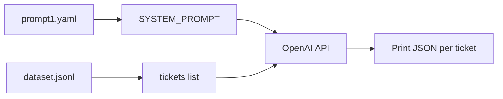

# Python virtual environment setup
_Exported on 11/2/2026 at 17:05:02 CST from Cursor (3.23.23)_

---

**User**

how do i create a virtual enviroment in python ?

---

**Cursor**

Creating a Python virtual environment keeps project dependencies isolated from your system Python. Here’s a practical guide on macOS (your OS).

## Using `venv` (built-in, recommended)

**1. Choose a folder for the project** (or use an existing one):

```bash
cd /path/to/your/project
```

**2. Create the environment:**

```bash
python3 -m venv .venv
```

Common names: `.venv`, `venv`, or `env`. `.venv` is widely used and often ignored by git.

**3. Activate it:**

```bash
source .venv/bin/activate
```

Your prompt usually shows `(.venv)`. `python` and `pip` then refer to that environment.

**4. Install packages (optional):**

```bash
pip install -r requirements.txt
# or
pip install some-package
```

**5. Deactivate when done:**

```bash
deactivate
```

---

## Quick reference

| Action        | Command                          |
|---------------|----------------------------------|
| Create        | `python3 -m venv .venv`          |
| Activate      | `source .venv/bin/activate`      |
| Deactivate    | `deactivate`                     |
| Upgrade pip   | `pip install --upgrade pip`      |
| Freeze deps   | `pip freeze > requirements.txt`  |

---

## Notes

- Use **`python3 -m venv`**, not bare `python`, if `python` isn’t Python 3 on your machine.
- Pick a **Python version** explicitly if needed:
  ```bash
  python3.12 -m venv .venv
  ```
- Add `.venv/` (or `venv/`) to **`.gitignore`**; commit `requirements.txt`, not the env folder.
- **Recreate** after deleting the folder: run `python3 -m venv .venv` again, activate, then reinstall packages.

---

## Alternatives (brief)

- **`virtualenv`**: third-party, similar API; install with `pip install virtualenv`, then `virtualenv .venv`.
- **Conda**: `conda create -n myenv python=3.12` then `conda activate myenv` — common in data science.

For most apps, **`python3 -m venv .venv`** plus **`source .venv/bin/activate`** is enough. If you want this wired into your `proyectoM1L1` repo (e.g. existing `requirements.txt`), say what’s in the project and we can match steps to it.

---

**User**

please help me add material to the  @README.md  look at the files inside @instructions/p1.txt  @instructions/p3.txt @instructions/p4.txt and @instructions/steps.txt and create a the @README.md base on that

---

**Cursor**

Reading the instruction files and the current README to draft the README.


Creating a README from the instruction files. The project is early-stage, so I'll include setup, structure, deliverables, and placeholders for eval results and context-engineering documentation.


Updated **`README.md`** using `instructions/p1.txt`, `p3.txt`, `p4.txt`, and `steps.txt`. It currently includes:

1. **Project overview** — Level-1 support triage, goals, and the JSON contract (`answer`, `confidence`, `category`, `actions`).
2. **Requirements** — Multi-provider LLM, Pydantic validation, retries, guardrails, `LLMProvider`, metrics.
3. **Repository layout** — Matches the file list in `steps.txt` (even though those folders are not in the repo yet).
4. **Setup** — Clone, virtualenv, `pip install`, `.env` from `.env.example`.
5. **Usage** — Example CLI command, sample JSON response, and a `metrics.jsonl` line.
6. **Context engineering** — Tables for prompt versions and model parameters (placeholders to fill after evals).
7. **Eval results table** — Global and per-category scores (to update after running the runner).
8. **Security** — Input/output guardrails from `p3.txt`.
9. **Development roadmap** — Steps from `steps.txt`.
10. **Delivery checklist** and **evaluation criteria** from `p3.txt` and `p4.txt`.

Because the codebase is still early (only `instructions/` and `.venv`), sections marked **“Completá / Actualizá / pendiente”** are intentional so you can drop in real commands, chosen prompt strategy, and eval numbers as you build.

If you want, we can next align `.env.example` and `requirements.txt` with the same README or switch tone to full English instead of Spanish.

---

**User**

please look at main.py and tell me what dependencies do i need to install in my virtual enviroment

---

**Cursor**

Based on `src/main.py`, you only need **two third-party packages**. Everything else is from the standard library.

| Import in code | Package to install | PyPI name |
|----------------|-------------------|-----------|
| `from dotenv import load_dotenv` | **python-dotenv** | `python-dotenv` |
| `from openai import OpenAI` | **OpenAI Python SDK** | `openai` |
| `import os` | *(built-in)* | — |

### Install in your virtual environment

With the venv activated:

```bash
pip install python-dotenv openai
```

Or pin versions (typical for a course project):

```bash
pip install python-dotenv openai
pip freeze > requirements.txt
```

### Environment variable

The code reads `OPENAI_API_KEY` from the environment (via `.env` after `load_dotenv()`). You do **not** install a package for that—just set it in `.env`:

```env
OPENAI_API_KEY=sk-...
```

### Optional (not used in `main.py` yet)

Your project instructions mention **Pydantic**, **YAML prompts**, and a second LLM provider later. When you add those files, you’ll likely also need:

- `pydantic` — validated JSON contract  
- `pyyaml` — `prompts/*.yaml`  
- Provider SDKs as you implement them (e.g. `google-generativeai` for Gemini, or `anthropic` for Anthropic)

For **only** the current `main.py`, **`python-dotenv`** and **`openai`** are enough.

---

**User**

create a .env example file with fake data please

---

**Cursor**

Creating `.env.example` with placeholder values matching your `.env` structure and project LLM settings.


Created **`.env.example`** with fake placeholders for:

- Your existing **DB_** variables (example user/password/database)
- **`OPENAI_API_KEY`** (fake `sk-proj-...` style key)
- Commented optional vars for a second provider and model settings (aligned with your triage project)

Copy and fill locally:

```bash
cp .env.example .env
```

`.env` is already in `.gitignore`, so it should not be committed. If that real key in `.env` was ever pushed or shared, rotate it in the OpenAI dashboard and update `.env` only.

---

**User**

please check my @.gitignore  is that file ok ? is it missing something ?

---

**Cursor**

Your `.gitignore` is the standard **Python template from gitignore.io**. For this triage project it covers the important parts; a few gaps are worth fixing.

## What’s already in good shape

| Item | Status |
|------|--------|
| **`.env`** (secrets) | Listed at line 127; Git ignores it (`git check-ignore` confirms). |
| **Virtual env** (`.venv`, `venv/`, etc.) | Lines 128–133. |
| **Python artifacts** (`__pycache__`, `.pytest_cache`, eggs, etc.) | Covered. |
| **Coverage / tox / mypy / ruff** | Covered. |

So for day-to-day Python work and keeping API keys out of the repo, the file is **mostly fine**.

## Issues / gaps

### 1. `.DS_Store` is not ignored (and may already be tracked)

macOS creates `.DS_Store` in folders. It’s **not** in your `.gitignore`, and **`git ls-files` shows `.DS_Store` is tracked**. You should add:

```gitignore
.DS_Store
**/.DS_Store
```

If it was committed before, remove it from the index (keep the file on disk):

```bash
git rm --cached .DS_Store
```

### 2. Extra env file patterns (optional but useful)

You only ignore `.env`. People often also ignore local overrides so nothing slips through:

```gitignore
.env.local
.env.*.local
```

Keep **`.env.example`** committed (do **not** add a rule that ignores it).

### 3. IDE folders (optional)

`.idea/` is **commented out** (lines 164–165). If you use PyCharm, uncomment it or add `.idea/`. For VS Code/Cursor, some teams ignore `.vscode/`; others commit shared settings—your choice.

### 4. Watch out for `lib/` (line 21)

The template ignores any top-level **`lib/`** directory. That’s normal for libraries, but if you ever add application code under a folder named `lib/`, Git would ignore it. With `src/` only, you’re fine for now.

### 5. What you should **not** ignore (for your assignment)

Per `instructions/p3.txt`, these should stay **in** the repo:

- `evals/dataset.jsonl`
- `evals/runner.py`
- `prompts/*.yaml`
- `data/metrics.jsonl` (as the metrics log deliverable—you may commit an empty file or sample lines, not ignore the whole `data/` folder unless you intentionally want metrics local-only)

Don’t add a blanket `data/` ignore unless you mean runtime-only logs.

## Verdict

**OK for a Python + `.env` + venv project.** The main fix on macOS is **`.DS_Store`** (and untrack it if it’s already committed). Optional improvements: **`.env.local` / `.env.*.local`**, and IDE entries if you use them.

I'm in Agent mode if you want these lines added to `.gitignore` and `.DS_Store` removed from tracking for you.

---

**User**

create a static ticket in @src/main.py with the text: "Hola, me cobraron dos veces la suscripción de este mes, necesito que me reintegren uno de los cargos." I will pass this ticket to the open ai api later 


---

**Cursor**

Adding a static `TICKET` constant and using it as the API message content so it's ready when you call OpenAI.


Updated `src/main.py` with a static **`TICKET`** constant (your billing double-charge message) and set the chat **`content`** to `TICKET` so the next API call uses that text.

When you add triage prompts or structured JSON, you can keep sending `TICKET` as the user message (or pass it from the CLI later).

---

**User**

ayudame a crear un prompt static en @src/main.py ocupa este texto @src/main.py:15-20 para crear el prompt el cual sera ocupado con el ticket @src/main.py:9-10 y la openAI API @src/main.py:24-31 

---

**Cursor**

Creando un prompt estático de sistema con las instrucciones del triage y enviando el ticket como mensaje de usuario.


Quedó así la estructura en `src/main.py`:

1. **`SYSTEM_PROMPT`** — Instrucciones estáticas de triage (clasificar, responder, acciones) y el contrato JSON con `answer`, `confidence`, `category` y `actions`, más la regla de responder solo JSON.

2. **Llamada a la API** — Dos mensajes:
   - `system` → `SYSTEM_PROMPT`
   - `user` → `TICKET` (el caso de cobro duplicado)

Al ejecutar el script, el modelo debería devolver JSON acorde al contrato del proyecto. El siguiente paso natural es validarlo con Pydantic y reintentar si el parseo falla.

Si querés, en Agent mode puedo añadir ese parseo y los reintentos.

---

**User**

please change the SYSTEM_PROMPT in @src/main.py @src/main.py:14 to the one in @prompts/prompt1.yaml 

---

**Cursor**

Convirtiendo `prompt1.yaml` a YAML válido y cargando el prompt desde ese archivo en `main.py`.


Here’s what changed:

### `src/main.py`
- Loads `prompts/prompt1.yaml` with **`PyYAML`**
- Sets **`SYSTEM_PROMPT`** from `prompt_data['system_prompt']`
- Removed the inline prompt string

### `prompts/prompt1.yaml`
The file was Python-style (`SYSTEM_PROMPT1 = """...`), not valid YAML. It’s now:

```yaml
name: prompt1
system_prompt: |
  Recibe un ticket, ...
```

Same text as before; only the format changed so it can be loaded.

### `requirements.txt`
- Added **`PyYAML==6.0.2`**

Install the new dependency in your venv:

```bash
source .venv/bin/activate
pip install PyYAML==6.0.2
```

Run as usual: `python src/main.py` (or `python -m src.main` if you add a package layout later).

---

**User**

ok now move the ticket in @src/main.py:12-15 to @evals/dataset.jsonl 

---

**Cursor**

Adding the ticket to `evals/dataset.jsonl` (with expected labels from `answer1.json`) and updating `main.py` to load it from there.


Here’s what changed:

### `evals/dataset.jsonl`
One labeled row with:
- **`id`**: `case_001`
- **`ticket`**: the billing message (moved from `main.py`)
- **`expected`**: same structure as `instructions/answer1.json` (for evals later)

### `src/main.py`
- Removed the hardcoded `TICKET` string
- Reads the **first line** of `evals/dataset.jsonl` and sets `TICKET = first_record['ticket']`

Behavior of the OpenAI call is unchanged; the text now lives in the dataset. When you add more cases, you can extend loading (e.g. by `id` or CLI flag) for `runner.py`.

---

**User**

no that is not rigth, please  just move the text in the ticket to @evals/dataset.jsonl  for now

---

**Cursor**

Dejando solo el texto del ticket en `dataset.jsonl` y restaurando `main.py` como antes (sin leer el dataset).


Eliminando el ticket duplicado en `main.py` y cargándolo solo desde `dataset.jsonl`.


Dejando el ticket solo en `dataset.jsonl` y restaurando `main.py` sin lectura del dataset, como pediste.


Corregido según lo que pediste:

### `evals/dataset.jsonl`
Una sola línea, solo el texto del ticket:

```json
{"ticket": "Hola, me cobraron dos veces la suscripción de este mes, necesito que me reintegren uno de los cargos."}
```

Sin `id`, sin `expected` ni etiquetas extra.

### `src/main.py`
El texto ya no está hardcodeado: se lee esa línea de `dataset.jsonl` y se usa en la llamada a la API.

Si preferís **solo** tener el ticket en el `.jsonl` y **seguir definiendo `TICKET` en `main.py`** (sin leer el archivo por ahora), decime y lo dejamos así.

---

**User**

ayuda a modificar el system_prompt en  @prompts/prompt1.yaml:2-3 toma en cuenta estos principios para hcer el prompt : @instructions/PromptCreation.txt:1-7 creo que en su mayoria el system_prompt que tenemos esta bien, solo faltaria  agregarle el 1  establece la perspectiva del modelo. Ej: "Eres un agente experto de soporte técnico..."

---

**Cursor**

Agregando la perspectiva del modelo al inicio y corrigiendo el YAML con `|` para que el prompt multilínea se cargue correctamente.


Updated **`prompts/prompt1.yaml`** with:

1. **Principle 1 (perspective)** — Opening line:  
   *"Eres un agente experto de soporte técnico y atención al cliente de primer nivel."*  
   (Covers billing/account tickets, not only technical.)

2. **Rest unchanged** — Classification, JSON contract, categories, `actions`, `confidence`, JSON-only response.

3. **YAML fix** — `system_prompt: |` so the full multiline prompt loads correctly in `main.py` (before, only the first line might have been parsed reliably).

Principle 2 (*"El siguiente es un ticket de cliente..."*) fits the **user** message with the ticket from `dataset.jsonl`; no need to repeat it in the system prompt unless you want it in both places.

---

**User**

now please help me add 2 more tickets in @evals/dataset.jsonl look at @instructions/p2.txt for examples of tickets and also look at the prompt @prompts/prompt1.yaml  and you can also look at @/Users/juanluissv/Desktop/python1/python2/m1/systemPrompt.py for reference 

---

**Cursor**

Agregando dos tickets de `p2.txt` en categorías distintas (technical y account) para complementar el caso de billing existente.


Added **2 tickets** to `evals/dataset.jsonl`, using the same `{"ticket": "..."}` format and examples from `p2.txt`:

| # | Category (expected) | Ticket |
|---|---------------------|--------|
| 1 | `billing` | Cobro duplicado de suscripción *(existing)* |
| 2 | `technical` | Error 500 en dashboard de reportes |
| 3 | `account` | Agregar usuario con permisos de solo lectura |

They align with `prompt1.yaml` categories: billing, technical, account, other.

**Note:** `main.py` still reads **only the first line** of the dataset. To run the other tickets you can switch lines, add a `--case` flag, or loop like in `systemPrompt.py` (`Ticket: {ticket}` in the user message). I can wire that in Agent mode if you want.

---

**User**

yes I want @src/main.py  to go through all the tickets in the dataset @evals/dataset.jsonl, help me make a look  like in @/Users/juanluissv/Desktop/python1/python2/m1/systemPrompt.py in @src/main.py 

---

**Cursor**

Updated `src/main.py` to mirror the loop in `systemPrompt.py`:

1. **Load all tickets** — Reads every non-empty line from `evals/dataset.jsonl`.
2. **Loop** — For each ticket, calls the API with:
   - `system` → `SYSTEM_PROMPT` from `prompt1.yaml`
   - `user` → `Ticket: {ticket}` (same pattern as the reference)
3. **Output** — Prints each ticket and its JSON response, with a blank line between cases.
4. **`response_format`** — Still uses `json_object` for structured output.

Run it with:

```bash
python src/main.py
```

You should see three blocks (billing, technical, account).

---

**User**

please explain @src/main.py  to me 

---

**Cursor**

Here’s what `src/main.py` does, step by step.

## Purpose

It’s a small **triage script**: for each support ticket in `evals/dataset.jsonl`, it calls OpenAI with your system prompt and prints a **JSON** response (`answer`, `confidence`, `category`, `actions`).

---

## 1. Setup and configuration (lines 1–11)

```1:11:src/main.py
import json
import os
from pathlib import Path

import yaml
from dotenv import load_dotenv
from openai import OpenAI

load_dotenv()

client = OpenAI(api_key=os.getenv('OPENAI_API_KEY'))
```

- **`load_dotenv()`** — Loads variables from `.env` (including `OPENAI_API_KEY`).
- **`OpenAI(...)`** — Client used for chat completions.
- **`json`** — Parses each line of the JSONL dataset.
- **`yaml`** — Reads `prompt1.yaml`.
- **`Path`** — Builds file paths relative to the project root.

---

## 2. File paths (lines 13–15)

```13:15:src/main.py
ROOT = Path(__file__).resolve().parent.parent
PROMPT_PATH = ROOT / 'prompts' / 'prompt1.yaml'
DATASET_PATH = ROOT / 'evals' / 'dataset.jsonl'
```

`main.py` lives in `src/`, so **`parent.parent`** is the project root. From there it finds the prompt and the dataset, no matter where you run the script from (as long as paths stay the same).

---

## 3. Load the system prompt (lines 17–20)

```17:20:src/main.py
with PROMPT_PATH.open(encoding='utf-8') as prompt_file:
	prompt_data = yaml.safe_load(prompt_file)

SYSTEM_PROMPT = prompt_data['system_prompt'].strip()
```

Opens **`prompts/prompt1.yaml`**, reads the `system_prompt` field, and trims whitespace. That text tells the model its role, the task, and the JSON format — **once**, shared by every ticket.

---

## 4. Load all tickets (lines 22–28)

```22:28:src/main.py
tickets = []
with DATASET_PATH.open(encoding='utf-8') as dataset_file:
	for line in dataset_file:
		line = line.strip()
		if not line:
			continue
		tickets.append(json.loads(line)['ticket'])
```

**JSONL** = one JSON object per line. Each line looks like `{"ticket": "..."}`. The script skips blank lines and builds a list of ticket strings.

---

## 5. Process each ticket (lines 30–44)

```32:44:src/main.py
for ticket in tickets:
	response = client.chat.completions.create(
		model='gpt-4o-mini',
		messages=[
			{'role': 'system', 'content': SYSTEM_PROMPT},
			{'role': 'user', 'content': f'Ticket: {ticket}'},
		],
		response_format={'type': 'json_object'},
	)

	print('ticket:', ticket)
	print('respuesta:', response.choices[0].message.content)
	print()
```

For **each** ticket:

| Piece | Role |
|--------|------|
| **`system`** | Instructions from YAML (perspective, task, JSON schema). |
| **`user`** | `Ticket: {text}` — the actual customer message (context + input). |
| **`response_format: json_object`** | Asks the API for valid JSON (helps match your contract). |
| **`gpt-4o-mini`** | Model used for each call. |

The reply text is in `response.choices[0].message.content`; the script prints the ticket and that JSON string, then a blank line before the next one.

---

## Flow (diagram)



---

## What it does *not* do yet

- No **Pydantic** validation or retries if JSON is wrong (beyond `json_object`).
- No writing to **`data/metrics.jsonl`** (tokens, latency, cost).
- No **CLI argument** to pick one ticket; it always runs the full dataset.
- **`evals/runner.py`** is separate — this file is for manual “run all tickets and see output.”

If you want to go deeper on one part (e.g. `messages` roles or `response_format`), say which section.

---

**User**

ok now please help I want to save the the response the answer from openAI API  @src/main.py:43-44 please save the answers in @evals/answers.jsonl 

---

**Cursor**

Guardando cada respuesta en `evals/answers.jsonl` (una línea por ticket, JSON parseado) y sobrescribiendo el archivo en cada ejecución completa para que coincida con el dataset.


Here’s what was added:

### Behavior
- After each API call, the script stores `{ "ticket": "...", "answer": { ... } }`, with `answer` as parsed JSON (`answer`, `confidence`, `category`, `actions`).
- When the loop finishes, it writes **all** records to **`evals/answers.jsonl`** (one JSON object per line).
- The file is **overwritten** on each full run so it stays aligned with `dataset.jsonl` (3 tickets → 3 lines).
- Console output is unchanged; you also get: `Guardadas N respuestas en ...`

### Example line in `answers.jsonl`
```json
{"ticket": "Hola, me cobraron...", "answer": {"answer": "...", "confidence": 0.9, "category": "billing", "actions": ["..."]}}
```

Run `python src/main.py` to generate the file. If you prefer **append** on every run instead of overwrite, say so and we can switch it.

