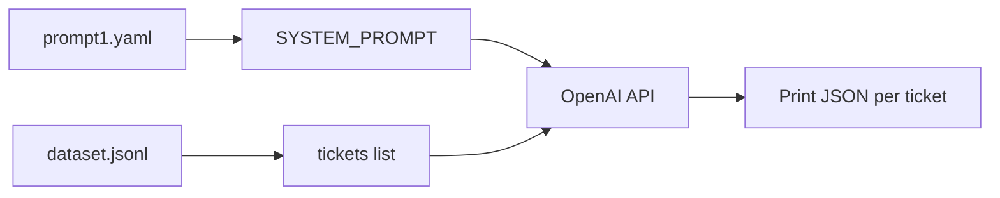
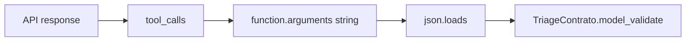
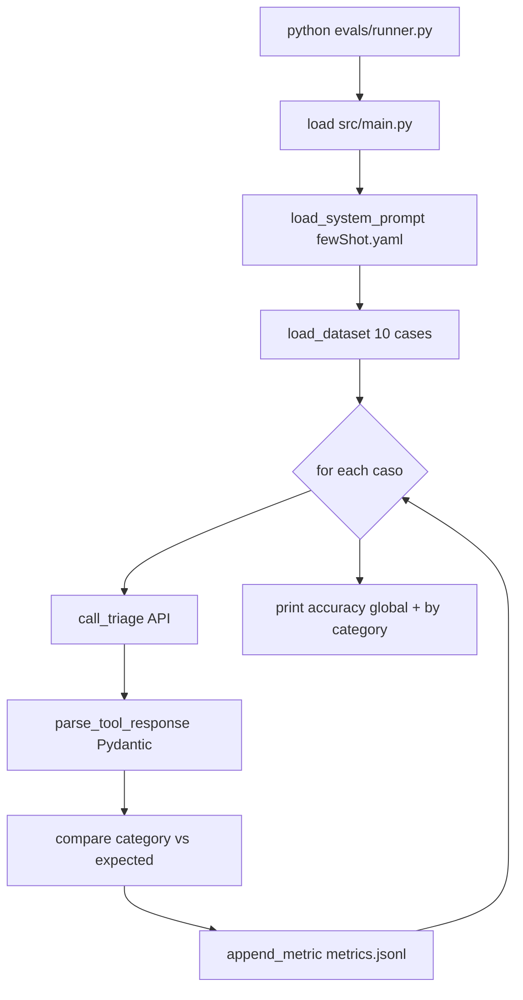

# Python virtual environment setup
_Exported on 11/7/2026 at 12:48:53 CST from Cursor (3.23.23)_

---

**User**

how do i create a virtual enviroment in python ?

---

**Cursor**

Creating a Python virtual environment keeps project dependencies isolated from your system Python. Here’s a practical guide on macOS (your OS).

## Using `venv` (built-in, recommended)

**1. Choose a folder for the project** (or use an existing one):

```bash
cd /path/to/your/project
```

**2. Create the environment:**

```bash
python3 -m venv .venv
```

Common names: `.venv`, `venv`, or `env`. `.venv` is widely used and often ignored by git.

**3. Activate it:**

```bash
source .venv/bin/activate
```

Your prompt usually shows `(.venv)`. `python` and `pip` then refer to that environment.

**4. Install packages (optional):**

```bash
pip install -r requirements.txt
# or
pip install some-package
```

**5. Deactivate when done:**

```bash
deactivate
```

---

## Quick reference

| Action        | Command                          |
|---------------|----------------------------------|
| Create        | `python3 -m venv .venv`          |
| Activate      | `source .venv/bin/activate`      |
| Deactivate    | `deactivate`                     |
| Upgrade pip   | `pip install --upgrade pip`      |
| Freeze deps   | `pip freeze > requirements.txt`  |

---

## Notes

- Use **`python3 -m venv`**, not bare `python`, if `python` isn’t Python 3 on your machine.
- Pick a **Python version** explicitly if needed:
  ```bash
  python3.12 -m venv .venv
  ```
- Add `.venv/` (or `venv/`) to **`.gitignore`**; commit `requirements.txt`, not the env folder.
- **Recreate** after deleting the folder: run `python3 -m venv .venv` again, activate, then reinstall packages.

---

## Alternatives (brief)

- **`virtualenv`**: third-party, similar API; install with `pip install virtualenv`, then `virtualenv .venv`.
- **Conda**: `conda create -n myenv python=3.12` then `conda activate myenv` — common in data science.

For most apps, **`python3 -m venv .venv`** plus **`source .venv/bin/activate`** is enough. If you want this wired into your `proyectoM1L1` repo (e.g. existing `requirements.txt`), say what’s in the project and we can match steps to it.

---

**User**

please help me add material to the  @README.md  look at the files inside @instructions/p1.txt  @instructions/p3.txt @instructions/p4.txt and @instructions/steps.txt and create a the @README.md base on that

---

**Cursor**

Reading the instruction files and the current README to draft the README.


Creating a README from the instruction files. The project is early-stage, so I'll include setup, structure, deliverables, and placeholders for eval results and context-engineering documentation.


Updated **`README.md`** using `instructions/p1.txt`, `p3.txt`, `p4.txt`, and `steps.txt`. It currently includes:

1. **Project overview** — Level-1 support triage, goals, and the JSON contract (`answer`, `confidence`, `category`, `actions`).
2. **Requirements** — Multi-provider LLM, Pydantic validation, retries, guardrails, `LLMProvider`, metrics.
3. **Repository layout** — Matches the file list in `steps.txt` (even though those folders are not in the repo yet).
4. **Setup** — Clone, virtualenv, `pip install`, `.env` from `.env.example`.
5. **Usage** — Example CLI command, sample JSON response, and a `metrics.jsonl` line.
6. **Context engineering** — Tables for prompt versions and model parameters (placeholders to fill after evals).
7. **Eval results table** — Global and per-category scores (to update after running the runner).
8. **Security** — Input/output guardrails from `p3.txt`.
9. **Development roadmap** — Steps from `steps.txt`.
10. **Delivery checklist** and **evaluation criteria** from `p3.txt` and `p4.txt`.

Because the codebase is still early (only `instructions/` and `.venv`), sections marked **“Completá / Actualizá / pendiente”** are intentional so you can drop in real commands, chosen prompt strategy, and eval numbers as you build.

If you want, we can next align `.env.example` and `requirements.txt` with the same README or switch tone to full English instead of Spanish.

---

**User**

please look at main.py and tell me what dependencies do i need to install in my virtual enviroment

---

**Cursor**

Based on `src/main.py`, you only need **two third-party packages**. Everything else is from the standard library.

| Import in code | Package to install | PyPI name |
|----------------|-------------------|-----------|
| `from dotenv import load_dotenv` | **python-dotenv** | `python-dotenv` |
| `from openai import OpenAI` | **OpenAI Python SDK** | `openai` |
| `import os` | *(built-in)* | — |

### Install in your virtual environment

With the venv activated:

```bash
pip install python-dotenv openai
```

Or pin versions (typical for a course project):

```bash
pip install python-dotenv openai
pip freeze > requirements.txt
```

### Environment variable

The code reads `OPENAI_API_KEY` from the environment (via `.env` after `load_dotenv()`). You do **not** install a package for that—just set it in `.env`:

```env
OPENAI_API_KEY=sk-...
```

### Optional (not used in `main.py` yet)

Your project instructions mention **Pydantic**, **YAML prompts**, and a second LLM provider later. When you add those files, you’ll likely also need:

- `pydantic` — validated JSON contract  
- `pyyaml` — `prompts/*.yaml`  
- Provider SDKs as you implement them (e.g. `google-generativeai` for Gemini, or `anthropic` for Anthropic)

For **only** the current `main.py`, **`python-dotenv`** and **`openai`** are enough.

---

**User**

create a .env example file with fake data please

---

**Cursor**

Creating `.env.example` with placeholder values matching your `.env` structure and project LLM settings.


Created **`.env.example`** with fake placeholders for:

- Your existing **DB_** variables (example user/password/database)
- **`OPENAI_API_KEY`** (fake `sk-proj-...` style key)
- Commented optional vars for a second provider and model settings (aligned with your triage project)

Copy and fill locally:

```bash
cp .env.example .env
```

`.env` is already in `.gitignore`, so it should not be committed. If that real key in `.env` was ever pushed or shared, rotate it in the OpenAI dashboard and update `.env` only.

---

**User**

please check my @.gitignore  is that file ok ? is it missing something ?

---

**Cursor**

Your `.gitignore` is the standard **Python template from gitignore.io**. For this triage project it covers the important parts; a few gaps are worth fixing.

## What’s already in good shape

| Item | Status |
|------|--------|
| **`.env`** (secrets) | Listed at line 127; Git ignores it (`git check-ignore` confirms). |
| **Virtual env** (`.venv`, `venv/`, etc.) | Lines 128–133. |
| **Python artifacts** (`__pycache__`, `.pytest_cache`, eggs, etc.) | Covered. |
| **Coverage / tox / mypy / ruff** | Covered. |

So for day-to-day Python work and keeping API keys out of the repo, the file is **mostly fine**.

## Issues / gaps

### 1. `.DS_Store` is not ignored (and may already be tracked)

macOS creates `.DS_Store` in folders. It’s **not** in your `.gitignore`, and **`git ls-files` shows `.DS_Store` is tracked**. You should add:

```gitignore
.DS_Store
**/.DS_Store
```

If it was committed before, remove it from the index (keep the file on disk):

```bash
git rm --cached .DS_Store
```

### 2. Extra env file patterns (optional but useful)

You only ignore `.env`. People often also ignore local overrides so nothing slips through:

```gitignore
.env.local
.env.*.local
```

Keep **`.env.example`** committed (do **not** add a rule that ignores it).

### 3. IDE folders (optional)

`.idea/` is **commented out** (lines 164–165). If you use PyCharm, uncomment it or add `.idea/`. For VS Code/Cursor, some teams ignore `.vscode/`; others commit shared settings—your choice.

### 4. Watch out for `lib/` (line 21)

The template ignores any top-level **`lib/`** directory. That’s normal for libraries, but if you ever add application code under a folder named `lib/`, Git would ignore it. With `src/` only, you’re fine for now.

### 5. What you should **not** ignore (for your assignment)

Per `instructions/p3.txt`, these should stay **in** the repo:

- `evals/dataset.jsonl`
- `evals/runner.py`
- `prompts/*.yaml`
- `data/metrics.jsonl` (as the metrics log deliverable—you may commit an empty file or sample lines, not ignore the whole `data/` folder unless you intentionally want metrics local-only)

Don’t add a blanket `data/` ignore unless you mean runtime-only logs.

## Verdict

**OK for a Python + `.env` + venv project.** The main fix on macOS is **`.DS_Store`** (and untrack it if it’s already committed). Optional improvements: **`.env.local` / `.env.*.local`**, and IDE entries if you use them.

I'm in Agent mode if you want these lines added to `.gitignore` and `.DS_Store` removed from tracking for you.

---

**User**

create a static ticket in @src/main.py with the text: "Hola, me cobraron dos veces la suscripción de este mes, necesito que me reintegren uno de los cargos." I will pass this ticket to the open ai api later 


---

**Cursor**

Adding a static `TICKET` constant and using it as the API message content so it's ready when you call OpenAI.


Updated `src/main.py` with a static **`TICKET`** constant (your billing double-charge message) and set the chat **`content`** to `TICKET` so the next API call uses that text.

When you add triage prompts or structured JSON, you can keep sending `TICKET` as the user message (or pass it from the CLI later).

---

**User**

ayudame a crear un prompt static en @src/main.py ocupa este texto @src/main.py:15-20 para crear el prompt el cual sera ocupado con el ticket @src/main.py:9-10 y la openAI API @src/main.py:24-31 

---

**Cursor**

Creando un prompt estático de sistema con las instrucciones del triage y enviando el ticket como mensaje de usuario.


Quedó así la estructura en `src/main.py`:

1. **`SYSTEM_PROMPT`** — Instrucciones estáticas de triage (clasificar, responder, acciones) y el contrato JSON con `answer`, `confidence`, `category` y `actions`, más la regla de responder solo JSON.

2. **Llamada a la API** — Dos mensajes:
   - `system` → `SYSTEM_PROMPT`
   - `user` → `TICKET` (el caso de cobro duplicado)

Al ejecutar el script, el modelo debería devolver JSON acorde al contrato del proyecto. El siguiente paso natural es validarlo con Pydantic y reintentar si el parseo falla.

Si querés, en Agent mode puedo añadir ese parseo y los reintentos.

---

**User**

please change the SYSTEM_PROMPT in @src/main.py @src/main.py:14 to the one in @prompts/prompt1.yaml 

---

**Cursor**

Convirtiendo `prompt1.yaml` a YAML válido y cargando el prompt desde ese archivo en `main.py`.


Here’s what changed:

### `src/main.py`
- Loads `prompts/prompt1.yaml` with **`PyYAML`**
- Sets **`SYSTEM_PROMPT`** from `prompt_data['system_prompt']`
- Removed the inline prompt string

### `prompts/prompt1.yaml`
The file was Python-style (`SYSTEM_PROMPT1 = """...`), not valid YAML. It’s now:

```yaml
name: prompt1
system_prompt: |
  Recibe un ticket, ...
```

Same text as before; only the format changed so it can be loaded.

### `requirements.txt`
- Added **`PyYAML==6.0.2`**

Install the new dependency in your venv:

```bash
source .venv/bin/activate
pip install PyYAML==6.0.2
```

Run as usual: `python src/main.py` (or `python -m src.main` if you add a package layout later).

---

**User**

ok now move the ticket in @src/main.py:12-15 to @evals/dataset.jsonl 

---

**Cursor**

Adding the ticket to `evals/dataset.jsonl` (with expected labels from `answer1.json`) and updating `main.py` to load it from there.


Here’s what changed:

### `evals/dataset.jsonl`
One labeled row with:
- **`id`**: `case_001`
- **`ticket`**: the billing message (moved from `main.py`)
- **`expected`**: same structure as `instructions/answer1.json` (for evals later)

### `src/main.py`
- Removed the hardcoded `TICKET` string
- Reads the **first line** of `evals/dataset.jsonl` and sets `TICKET = first_record['ticket']`

Behavior of the OpenAI call is unchanged; the text now lives in the dataset. When you add more cases, you can extend loading (e.g. by `id` or CLI flag) for `runner.py`.

---

**User**

no that is not rigth, please  just move the text in the ticket to @evals/dataset.jsonl  for now

---

**Cursor**

Dejando solo el texto del ticket en `dataset.jsonl` y restaurando `main.py` como antes (sin leer el dataset).


Eliminando el ticket duplicado en `main.py` y cargándolo solo desde `dataset.jsonl`.


Dejando el ticket solo en `dataset.jsonl` y restaurando `main.py` sin lectura del dataset, como pediste.


Corregido según lo que pediste:

### `evals/dataset.jsonl`
Una sola línea, solo el texto del ticket:

```json
{"ticket": "Hola, me cobraron dos veces la suscripción de este mes, necesito que me reintegren uno de los cargos."}
```

Sin `id`, sin `expected` ni etiquetas extra.

### `src/main.py`
El texto ya no está hardcodeado: se lee esa línea de `dataset.jsonl` y se usa en la llamada a la API.

Si preferís **solo** tener el ticket en el `.jsonl` y **seguir definiendo `TICKET` en `main.py`** (sin leer el archivo por ahora), decime y lo dejamos así.

---

**User**

ayuda a modificar el system_prompt en  @prompts/prompt1.yaml:2-3 toma en cuenta estos principios para hcer el prompt : @instructions/PromptCreation.txt:1-7 creo que en su mayoria el system_prompt que tenemos esta bien, solo faltaria  agregarle el 1  establece la perspectiva del modelo. Ej: "Eres un agente experto de soporte técnico..."

---

**Cursor**

Agregando la perspectiva del modelo al inicio y corrigiendo el YAML con `|` para que el prompt multilínea se cargue correctamente.


Updated **`prompts/prompt1.yaml`** with:

1. **Principle 1 (perspective)** — Opening line:  
   *"Eres un agente experto de soporte técnico y atención al cliente de primer nivel."*  
   (Covers billing/account tickets, not only technical.)

2. **Rest unchanged** — Classification, JSON contract, categories, `actions`, `confidence`, JSON-only response.

3. **YAML fix** — `system_prompt: |` so the full multiline prompt loads correctly in `main.py` (before, only the first line might have been parsed reliably).

Principle 2 (*"El siguiente es un ticket de cliente..."*) fits the **user** message with the ticket from `dataset.jsonl`; no need to repeat it in the system prompt unless you want it in both places.

---

**User**

now please help me add 2 more tickets in @evals/dataset.jsonl look at @instructions/p2.txt for examples of tickets and also look at the prompt @prompts/prompt1.yaml  and you can also look at @/Users/juanluissv/Desktop/python1/python2/m1/systemPrompt.py for reference 

---

**Cursor**

Agregando dos tickets de `p2.txt` en categorías distintas (technical y account) para complementar el caso de billing existente.


Added **2 tickets** to `evals/dataset.jsonl`, using the same `{"ticket": "..."}` format and examples from `p2.txt`:

| # | Category (expected) | Ticket |
|---|---------------------|--------|
| 1 | `billing` | Cobro duplicado de suscripción *(existing)* |
| 2 | `technical` | Error 500 en dashboard de reportes |
| 3 | `account` | Agregar usuario con permisos de solo lectura |

They align with `prompt1.yaml` categories: billing, technical, account, other.

**Note:** `main.py` still reads **only the first line** of the dataset. To run the other tickets you can switch lines, add a `--case` flag, or loop like in `systemPrompt.py` (`Ticket: {ticket}` in the user message). I can wire that in Agent mode if you want.

---

**User**

yes I want @src/main.py  to go through all the tickets in the dataset @evals/dataset.jsonl, help me make a look  like in @/Users/juanluissv/Desktop/python1/python2/m1/systemPrompt.py in @src/main.py 

---

**Cursor**

Updated `src/main.py` to mirror the loop in `systemPrompt.py`:

1. **Load all tickets** — Reads every non-empty line from `evals/dataset.jsonl`.
2. **Loop** — For each ticket, calls the API with:
   - `system` → `SYSTEM_PROMPT` from `prompt1.yaml`
   - `user` → `Ticket: {ticket}` (same pattern as the reference)
3. **Output** — Prints each ticket and its JSON response, with a blank line between cases.
4. **`response_format`** — Still uses `json_object` for structured output.

Run it with:

```bash
python src/main.py
```

You should see three blocks (billing, technical, account).

---

**User**

please explain @src/main.py  to me 

---

**Cursor**

Here’s what `src/main.py` does, step by step.

## Purpose

It’s a small **triage script**: for each support ticket in `evals/dataset.jsonl`, it calls OpenAI with your system prompt and prints a **JSON** response (`answer`, `confidence`, `category`, `actions`).

---

## 1. Setup and configuration (lines 1–11)

```1:11:src/main.py
import json
import os
from pathlib import Path

import yaml
from dotenv import load_dotenv
from openai import OpenAI

load_dotenv()

client = OpenAI(api_key=os.getenv('OPENAI_API_KEY'))
```

- **`load_dotenv()`** — Loads variables from `.env` (including `OPENAI_API_KEY`).
- **`OpenAI(...)`** — Client used for chat completions.
- **`json`** — Parses each line of the JSONL dataset.
- **`yaml`** — Reads `prompt1.yaml`.
- **`Path`** — Builds file paths relative to the project root.

---

## 2. File paths (lines 13–15)

```13:15:src/main.py
ROOT = Path(__file__).resolve().parent.parent
PROMPT_PATH = ROOT / 'prompts' / 'prompt1.yaml'
DATASET_PATH = ROOT / 'evals' / 'dataset.jsonl'
```

`main.py` lives in `src/`, so **`parent.parent`** is the project root. From there it finds the prompt and the dataset, no matter where you run the script from (as long as paths stay the same).

---

## 3. Load the system prompt (lines 17–20)

```17:20:src/main.py
with PROMPT_PATH.open(encoding='utf-8') as prompt_file:
	prompt_data = yaml.safe_load(prompt_file)

SYSTEM_PROMPT = prompt_data['system_prompt'].strip()
```

Opens **`prompts/prompt1.yaml`**, reads the `system_prompt` field, and trims whitespace. That text tells the model its role, the task, and the JSON format — **once**, shared by every ticket.

---

## 4. Load all tickets (lines 22–28)

```22:28:src/main.py
tickets = []
with DATASET_PATH.open(encoding='utf-8') as dataset_file:
	for line in dataset_file:
		line = line.strip()
		if not line:
			continue
		tickets.append(json.loads(line)['ticket'])
```

**JSONL** = one JSON object per line. Each line looks like `{"ticket": "..."}`. The script skips blank lines and builds a list of ticket strings.

---

## 5. Process each ticket (lines 30–44)

```32:44:src/main.py
for ticket in tickets:
	response = client.chat.completions.create(
		model='gpt-4o-mini',
		messages=[
			{'role': 'system', 'content': SYSTEM_PROMPT},
			{'role': 'user', 'content': f'Ticket: {ticket}'},
		],
		response_format={'type': 'json_object'},
	)

	print('ticket:', ticket)
	print('respuesta:', response.choices[0].message.content)
	print()
```

For **each** ticket:

| Piece | Role |
|--------|------|
| **`system`** | Instructions from YAML (perspective, task, JSON schema). |
| **`user`** | `Ticket: {text}` — the actual customer message (context + input). |
| **`response_format: json_object`** | Asks the API for valid JSON (helps match your contract). |
| **`gpt-4o-mini`** | Model used for each call. |

The reply text is in `response.choices[0].message.content`; the script prints the ticket and that JSON string, then a blank line before the next one.

---

## Flow (diagram)



---

## What it does *not* do yet

- No **Pydantic** validation or retries if JSON is wrong (beyond `json_object`).
- No writing to **`data/metrics.jsonl`** (tokens, latency, cost).
- No **CLI argument** to pick one ticket; it always runs the full dataset.
- **`evals/runner.py`** is separate — this file is for manual “run all tickets and see output.”

If you want to go deeper on one part (e.g. `messages` roles or `response_format`), say which section.

---

**User**

ok now please help I want to save the the response the answer from openAI API  @src/main.py:43-44 please save the answers in @evals/answers.jsonl 

---

**Cursor**

Guardando cada respuesta en `evals/answers.jsonl` (una línea por ticket, JSON parseado) y sobrescribiendo el archivo en cada ejecución completa para que coincida con el dataset.


Here’s what was added:

### Behavior
- After each API call, the script stores `{ "ticket": "...", "answer": { ... } }`, with `answer` as parsed JSON (`answer`, `confidence`, `category`, `actions`).
- When the loop finishes, it writes **all** records to **`evals/answers.jsonl`** (one JSON object per line).
- The file is **overwritten** on each full run so it stays aligned with `dataset.jsonl` (3 tickets → 3 lines).
- Console output is unchanged; you also get: `Guardadas N respuestas en ...`

### Example line in `answers.jsonl`
```json
{"ticket": "Hola, me cobraron...", "answer": {"answer": "...", "confidence": 0.9, "category": "billing", "actions": ["..."]}}
```

Run `python src/main.py` to generate the file. If you prefer **append** on every run instead of overwrite, say so and we can switch it.

---

**User**

ok I made a mistake I need your help to fix it, the ticket should not come from the dataset @evals/dataset.jsonl it should come from the user, the user should write the ticket in the terminal when i runs @src/main.py , so when the user runs  it should be something like:  python3 main.py --query "Me cobraron dos veces la suscripción". please help me fix this leave the @evals/dataset.jsonl as it is (because I will use it later) but remove it from main @src/main.py:15-16 , and make @src/main.py take the query from the terminal ( python3 main.py --query "Me cobraron dos veces la suscripción".)

---

**Cursor**

Refactoring `main.py` to accept `--query` from the CLI and append each response to `answers.jsonl`.


Here’s what changed:

### Removed
- Loading from `evals/dataset.jsonl` and `DATASET_PATH`
- Loop over multiple tickets

### Added
- **`argparse`** with required **`--query`**
- **`main()`** + `if __name__ == '__main__'` for a normal CLI entrypoint

### Answers file
- Each run **appends** one line to `evals/answers.jsonl` (so earlier runs are kept)

### How to run

From the project root:

```bash
python3 src/main.py --query "Me cobraron dos veces la suscripción"
```

From `src/`:

```bash
cd src
python3 main.py --query "Me cobraron dos veces la suscripción"
```

Without `--query`, argparse prints usage and exits. `evals/dataset.jsonl` is unchanged for your evals later.

---

**User**

please explain to me why @src/main.py  needs to have this :  @src/main.py:69-70 f __name__ == '__main__' .   what is it for ?

---

**Cursor**

`if __name__ == '__main__':` controls **when** the code in that block runs. It’s a common Python pattern for scripts that can also be imported as modules.

## What Python sets on every file

When Python loads a file, it sets a variable **`__name__`**:

| How the file is used | Value of `__name__` |
|----------------------|---------------------|
| You run it directly: `python3 src/main.py` | `'__main__'` |
| Another file does `import main` (or imports from `src`) | `'main'` (the module name) |

So **`__name__ == '__main__'`** is true only when that file is the **entry point** you executed, not when something else imports it.

## What your lines do

```69:70:src/main.py
if __name__ == '__main__':
	main()
```

Meaning:

- **Run as CLI** → call `main()` (parse `--query`, call OpenAI, print, save to `answers.jsonl`).
- **Imported** → definitions like `parse_args`, `load_system_prompt`, and `main` exist, but **`main()` is not called automatically**. Another script could do `from main import load_system_prompt` without triggering a full triage run.

## Why that matters for your project

Without the guard, putting `main()` at the bottom **unconditionally** would mean:

```python
main()  # always runs on import
```

Then `evals/runner.py` doing `import main` or importing helpers from `main.py` could accidentally hit the API, require `--query`, or fail—every import would behave like running the CLI.

With the guard, **`main.py` is both**:

1. A **program**: `python3 src/main.py --query "..."`
2. A **module**: reusable functions without side effects on import

## Short analogy

- **`def main():`** = recipe (“how to run triage”).
- **`if __name__ == '__main__': main()`** = “only cook when someone runs this file directly, not when they only borrow the recipe book.”

## Do you always need it?

For a tiny homework script with only a `main()` at the bottom, you *could* skip it and call `main()` directly—it often still works if nothing imports the file.

For anything that might grow (`runner.py`, tests, `llm_provider.py`), the guard is **good practice** and matches how real CLIs are structured.

**Bottom line:** those two lines ensure **`main()` runs only when you execute `main.py` from the terminal**, not when Python loads the file as an imported module.

---

**User**

I just move apiAnswersRecords apiAnswersRecords/answers.jsonl  to another folder please make sure the patch is not broken in main.py

---

**Cursor**

Updated **`ANSWERS_PATH`** in `src/main.py`:

```python
ANSWERS_PATH = ROOT / 'apiAnswersRecords' / 'answers.jsonl'
```

Append behavior is unchanged: the folder is created if needed, and each run adds a line to `apiAnswersRecords/answers.jsonl`. No other references to `evals/answers.jsonl` were in the project code.

---

**User**

I change the prompt name to @prompts/zeroShot.yaml zeroShot please make sure that this change name is not broken in @src/main.py 

---

**Cursor**

Updated `src/main.py` so the prompt path is:

```python
PROMPT_PATH = ROOT / 'prompts' / 'zeroShot.yaml'
```

`load_system_prompt()` still reads the `system_prompt` field from that file, which matches `zeroShot.yaml`. Nothing else in the project code referenced `prompt1.yaml`.

---

**User**

ok now I want to create a new prompt in @prompts/fewShot.yaml this prompt is few shot take this text in cosideration to design the prompt: @instructions/PromptCreation.txt:9-14  and you can take the examples for the few shot prompt from @apiAnswersRecords/answers.jsonl 

---

**Cursor**

Creando `fewShot.yaml` con un system prompt conciso y 3 pares input–output de `answers.jsonl` (billing, technical, account).


Created **`prompts/fewShot.yaml`** with this layout:

### Design (from `PromptCreation.txt`)
- **System prompt (principles 1, 3, 4):** role, task, JSON contract — shorter than zero-shot because behavior is shown by examples.
- **Few-shot (principles 9–14):** **3 ticket → JSON pairs** embedded in `system_prompt`, taken from the first 3 lines of `apiAnswersRecords/answers.jsonl` (`billing`, `technical`, `account`).
- Closing line: the **new ticket** arrives in the user message (same as `main.py`: `Ticket: {query}`).

### Two layers in the file
| Key | Purpose |
|-----|--------|
| **`system_prompt`** | What `main.py` loads today — full text including the 3 examples. |
| **`examples`** | Structured copies for evals, docs, or a future runner that builds user/assistant turns. |

The 4th record in `answers.jsonl` (`como cambio mi usuario?`) was left out so you stay at **3 examples** and avoid two similar `account` cases.

### Try few-shot in the CLI
Point `main.py` at the new file (or add a `--prompt` flag later):

```python
PROMPT_PATH = ROOT / 'prompts' / 'fewShot.yaml'
```

If you want, we can add `--prompt zeroShot|fewShot` so you can switch without editing code.

---

**User**

please make the new prompt @prompts/fewShot.yaml the main prompt in @src/main.py 

---

**Cursor**

Updated `src/main.py` so the default prompt file is **`prompts/fewShot.yaml`**. `load_system_prompt()` still reads the `system_prompt` field, which matches that file.

Run as usual:

```bash
python3 src/main.py --query "tu ticket aquí"
```

---

**User**

@src/main.py:8-10 what do i need to install for those ?

---

**Cursor**

Here’s what those imports need:

| Import | Package to install? |
|--------|---------------------|
| `from pydantic import BaseModel, Field` | **Yes — `pydantic`** (already in your `requirements.txt` as `pydantic==2.14.2`) |
| `from typing import Literal` | **No** — built into Python 3.8+ |
| `from enum import Enum` | **No** — standard library |

Install everything for the project (including Pydantic):

```bash
source .venv/bin/activate
pip install -r requirements.txt
```

Or only Pydantic:

```bash
pip install pydantic
```

Pydantic v2 also pulls in **`pydantic_core`** and **`annotated-types`**, which you already list in `requirements.txt`.

---

**User**

ok please help me with @src/main.py i am trying to add pydantic and usit with open ai tools just like in the file @/Users/juanluissv/Desktop/python1/python2/m1/functionCalling1.py , can you please check @src/main.py and make sure that pydantic is use with  open ai tools (use @/Users/juanluissv/Desktop/python1/python2/m1/functionCalling1.py  as a reference )

---

**Cursor**

Integrating tool-calling flow from the reference: parse `tool_calls` arguments and validate with Pydantic. Aligning the model with the project contract (`actions` as strings, not the hotel `Accion` enum).


Here’s what was wrong and what we changed.

### Problems in your version
1. **`message.content`** — With forced tool use, the model usually returns **`tool_calls`**, not JSON in `content` (often `None`).
2. **`json.loads(raw_content)`** — Same as the reference: read **`tool_calls[0].function.arguments`**, then `json.loads`, then **Pydantic** `model_validate`.
3. **`Accion` enum** — Copied from the hotel example; your prompt/`answers.jsonl` use **free-text** actions (e.g. “Iniciar el proceso de reembolso”), not `derivar_agente`, etc. **`actions` is now `list[str]`**.
4. **Tool definition** — Added **`description`** on the function (recommended by OpenAI).

### Flow (same idea as `functionCalling1.py`)

```text
OpenAI call with tools + tool_choice
  → message.tool_calls[0].function.arguments  (string)
  → json.loads(...)
  → TriageContrato.model_validate(...)        (Pydantic)
  → model_dump() for print / answers.jsonl
```

### `TriageContrato` (project contract)

- `answer`, `confidence`, `category` ∈ `billing|technical|account|other`, `actions: list[str]`
- Schema for the API: `TriageContrato.model_json_schema()`

Run:

```bash
python3 src/main.py --query "Me cobraron dos veces la suscripción"
```

If you later want **retries** when validation fails (as in `p3.txt`), we can add a small loop around `call_triage` + `parse_tool_response`.

---

**User**

please explain to me the changes that you just made

---

**Cursor**

Here’s a concise walkthrough of what changed and why.

## Before vs after (how the model returns data)

**Before (your draft):** You used `tools` + `tool_choice`, but still read **`message.content`** and ran `json.loads` on it — the same as **`response_format={"type": "json_object"}`**.

**After:** With **function calling**, the structured payload lives in **`message.tool_calls[0].function.arguments`** (a JSON **string**). `content` is often `null`. That matches `functionCalling1.py`.



---

## 1. Pydantic contract (`TriageContrato`)

```27:33:src/main.py
class TriageContrato(BaseModel):
	answer: str = Field(min_length=1)
	confidence: float = Field(ge=0.0, le=1.0)
	category: CategoriaValida
	actions: list[str] = Field(min_length=1)

TOOL_SCHEMA = TriageContrato.model_json_schema()
```

- Fields match your project: `answer`, `confidence`, `category`, `actions`.
- **`category`** is restricted with `Literal['billing', 'technical', 'account', 'other']` instead of a hacky `Literal.__getitem__(tuple(...))`.
- **`actions`** is **`list[str]`**, not `list[Accion]`. Your few-shot examples and `answers.jsonl` use human-readable strings (“Iniciar el proceso de reembolso”), not hotel enums like `derivar_agente`.
- **`TOOL_SCHEMA`** is the JSON Schema OpenAI uses for the tool **`parameters`** (same idea as the reference).

The **`Accion` enum** was removed because it didn’t match your support triage domain or your prompts.

---

## 2. OpenAI tools setup (`call_triage`)

```54:73:src/main.py
def call_triage(system_prompt: str, ticket: str):
	return client.chat.completions.create(
		...
		tools=[{
			'type': 'function',
			'function': {
				'name': TOOL_NAME,
				'description': TOOL_DESCRIPTION,
				'parameters': TOOL_SCHEMA,
			},
		}],
		tool_choice={
			'type': 'function',
			'function': {'name': TOOL_NAME},
		},
	)
```

- **`tools`**: declares one function, `clasificar_consulta`, whose arguments must follow `TriageContrato`’s schema.
- **`tool_choice`**: forces the model to **call that function** instead of replying in free text.
- **`description`**: short explanation for the model (your reference only had `name` + `parameters`; this is a small improvement).

The API call was moved into **`call_triage`** so `main()` stays readable.

---

## 3. Reading and validating the response (`parse_tool_response`)

```76:93:src/main.py
def parse_tool_response(response) -> TriageContrato:
	message = response.choices[0].message
	if not message.tool_calls:
		raise SystemExit(...)

	raw_args = message.tool_calls[0].function.arguments
	args_dict = json.loads(raw_args)
	return TriageContrato.model_validate(args_dict)
```

Steps (same as `functionCalling1.py`):

1. Take **`tool_calls[0].function.arguments`** (string).
2. **`json.loads`** → dict.
3. **`TriageContrato.model_validate(...)`** → typed, validated object (types, ranges, allowed categories, non-empty `actions`).

If there are no tool calls, JSON is broken, or validation fails, the script exits with a clear message (`ValidationError` included).

---

## 4. Output and saving (`main`)

```104:114:src/main.py
	triage = parse_tool_response(response)

	record = {'ticket': ticket, 'answer': triage.model_dump()}
	output_json = json.dumps(triage.model_dump(), ensure_ascii=False)
```

- You work with a **`TriageContrato`** instance, not a loose dict.
- **`model_dump()`** turns it into a plain dict for printing and for **`apiAnswersRecords/answers.jsonl`** (same shape as before: `ticket` + `answer`).

---

## What stayed the same

- CLI: **`--query`**
- Prompt from **`prompts/fewShot.yaml`**
- Append to **`apiAnswersRecords/answers.jsonl`**
- User message: **`Ticket: {query}`**

---

## Why both YAML prompt JSON instructions and tools?

The YAML still describes the JSON shape for the model (few-shot examples). **Tools + Pydantic** enforce that shape on your side: the API gets a schema, and Python **re-validates** after the call. That’s the “structured output + contract” requirement from your project instructions.

If you want next steps, the usual ones are **automatic retries** when `model_validate` fails and logging **tokens/latency/cost** to `data/metrics.jsonl`.

---

**User**

I need your helo to make the a dataset for evals in @evals/dataset.jsonl you can take a look at @instructions/p2.txt  and @apiAnswersRecords/answers.jsonl and @/Users/juanluissv/Desktop/python1/python2/m1/evals/03datasetEval.py for reference of how the dataset should be, also look at the prompt @prompts/fewShot.yaml  for reference, for now the dataset should have 10 tickets

---

**Cursor**

Gathering reference files and building a 10-row `evals/dataset.jsonl` that matches the eval format.


Creating `evals/dataset.jsonl` with 10 lines matching the reference structure (`id`, `texto`, `categoria_esperada`, `dificultad`, `nota`), using `p2.txt` and `answers.jsonl` for ticket text and category ground truth.


Here's what was added to **`evals/dataset.jsonl`**:

### Format (same idea as `03datasetEval.py`)
Each line is one JSON object with:

| Field | Meaning |
|--------|--------|
| `id` | `EVAL-001` … `EVAL-010` |
| `texto` | Ticket text (from **`instructions/p2.txt`** and **`apiAnswersRecords/answers.jsonl`**) |
| `categoria_esperada` | Expected class: `billing`, `technical`, `account`, `other` (aligned with **`prompts/fewShot.yaml`** / your Pydantic tool) |
| `dificultad` | `facil`, `medio`, or `ambiguo` |
| `nota` | Short reason / edge-case hint (like the millas example) |

### Mix
- **3** billing (`EVAL-001`, `EVAL-002` + you could count overlaps — actually billing: 001, 002 = 2; technical: 003, 004, 010 = 3; account: 005, 006, 009 = 3; other: 007, 008 = 2 → 2+3+3+2 = 10.

Distribution: **2 billing, 3 technical, 3 account, 2 other.**

### Notes for `runner.py`
- Read each line with **`texto`** as the model input.
- Compare the model’s **`category`** to **`categoria_esperada`** for accuracy (global and per category).

When you need **≥30** cases (per `evals.txt`), add more lines with the same shape. I can help wire **`evals/runner.py`** to this schema next if you want.

---

**User**

yes now help me make @evals/runner.py I want you to look and use as a reference @/Users/juanluissv/Desktop/python1/python2/m1/evals/registroTokens.py to make @evals/runner.py I want you to save the results in @data/metrics.jsonl and each saved json should incude: timestamp, "provider": "openai", "model": "gpt-4o-mini", prompt_tokens, completion_tokens, total_tokens, latency_s, cost_usd. so you can use  @/Users/juanluissv/Desktop/python1/python2/m1/evals/registroTokens.py and @/Users/juanluissv/Desktop/python1/python2/m1/evals/eval_v2.jsonl as a reference 


---

**Cursor**

Reading reference files and project code to implement the eval runner.


Implementing `evals/runner.py`: load dataset, call the same triage logic as `src/main.py` via `importlib`, compute accuracy and token costs, append one metrics JSON line per case. Clearing placeholder lines from `data/metrics.jsonl`.


Handling API failures during eval runs so we record a metrics line and continue instead of exiting.


Here’s what was added and how it works.

## `evals/runner.py`

- **Loads** `evals/dataset.jsonl` (each line: `id`, `texto`, `categoria_esperada`, …).
- **Reuses** the same flow as the CLI by loading `src/main.py` with `importlib` and calling:
  - `load_system_prompt()`
  - `call_triage(system_prompt, texto)`
  - `parse_tool_response(response)`
- **For each case** measures **`time.perf_counter()`** around the API call.
- **Reads** `response.usage` → `prompt_tokens`, `completion_tokens`, `total_tokens`.
- **Cost** (same idea as `registroTokens.py`):  
  `prompt * 0.15/1e6 + completion * 0.60/1e6` for **gpt-4o-mini**.
- **Appends** one JSON object per request to **`data/metrics.jsonl`** with:
  - `timestamp` (UTC ISO)
  - `provider`: `"openai"`
  - `model`: from the API response (fallback `"gpt-4o-mini"`)
  - `prompt_tokens`, `completion_tokens`, `total_tokens`
  - `latency_s`, `cost_usd`

Extra fields (for debugging the eval without losing the required ones):  
`eval_id`, `category_expected`, `category_predicted`, `category_correct`.

- **Prints** per-row OK/FAIL, then **global accuracy** and **per-category** accuracy.
- If **`parse_tool_response`** fails, it treats prediction as `__error__`, still logs metrics, and continues.

## `data/metrics.jsonl`

The old placeholder text was removed so the file is **empty** until you run the runner (append-only JSONL from then on).

## Run (needs network + `OPENAI_API_KEY`)

```bash
cd /Users/juanluissv/Desktop/proyectoM1L1
source .venv/bin/activate
python evals/runner.py
```

If you want metrics to contain **only** the fields you listed (no `eval_id` / `category_*`), say so and we can trim them or move eval metadata to a separate file.

---

**User**

please explain in detail @evals/runner.py to me

---

**Cursor**

Here is a detailed walkthrough of **`evals/runner.py`**: what it does, how the pieces fit together, and how it relates to `src/main.py` and your course references.

## Purpose

The runner is an **executable eval script** (not pytest). It:

1. Reads labeled cases from **`evals/dataset.jsonl`**
2. Runs **the same triage pipeline** as the CLI (`prompts/fewShot.yaml` + OpenAI tools + Pydantic)
3. Compares the model’s **`category`** to **`categoria_esperada`**
4. **Appends** one metrics line per API call to **`data/metrics.jsonl`**
5. Prints **global and per-category accuracy**

That matches the idea of `registroTokens.py` + `eval_v2.jsonl`, but adapted to your project (billing/technical/account/other and full tool-based triage).

---

## High-level flow



---

## Paths and constants (lines 15–24)

```15:24:evals/runner.py
ROOT = Path(__file__).resolve().parent.parent
DATASET_PATH = ROOT / 'evals' / 'dataset.jsonl'
METRICS_PATH = ROOT / 'data' / 'metrics.jsonl'
MAIN_PATH = ROOT / 'src' / 'main.py'
...
PRICE_PROMPT_PER_TOKEN = 0.15 / 1_000_000
PRICE_COMPLETION_PER_TOKEN = 0.60 / 1_000_000
PROVIDER = 'openai'
```

- **`ROOT`**: project root (`runner.py` is in `evals/`, so parent.parent).
- **`DATASET_PATH`**: ground-truth eval cases.
- **`METRICS_PATH`**: append-only log (one request = one line).
- **`MAIN_PATH`**: same logic as production CLI, without duplicating code.
- **Prices**: same rough **gpt-4o-mini** estimate as `registroTokens.py` ($0.15 / 1M input, $0.60 / 1M output). These are **estimates**, not exact billing from OpenAI’s dashboard.

---

## `load_triage_module()` — why not a normal import? (lines 27–34)

```27:34:evals/runner.py
def load_triage_module():
	spec = importlib.util.spec_from_file_location('triage_main', MAIN_PATH)
	...
	spec.loader.exec_module(mod)
	return mod
```

Your repo has **`src/main.py`**, not a package `src/` with `__init__.py`. So `from src.main import ...` often fails.

`importlib` **loads `main.py as a module** and gives you:

- `load_system_prompt`
- `call_triage`
- `parse_tool_response`
- `TriageContrato` / tool setup behind those functions

Importing **`main.py`** runs its top level (`load_dotenv()`, `OpenAI(...)`), same as when you run the CLI — but it does **not** call `main()`, because `if __name__ == '__main__'` is false when loaded as `triage_main`.

---

## `load_dataset()` (lines 37–50)

- Opens **`evals/dataset.jsonl`**
- Each non-empty line → `json.loads` → one dict (`id`, `texto`, `categoria_esperada`, …)
- Invalid JSON → clear error with **line number**

The runner only **requires** `texto` and `categoria_esperada` for scoring; `dificultad` / `nota` are metadata for humans.

---

## `estimate_cost_usd()` and `append_metric()` (lines 53–63)

- **`estimate_cost_usd`**: linear cost from prompt + completion token counts (reference-style).
- **`append_metric`**: creates `data/` if needed, opens **`metrics.jsonl` in mode `'a'`** — each run **adds** lines; it does not wipe the file.

---

## Core loop: `run()` (lines 66–145)

### Setup (67–77)

1. Load triage module from `src/main.py`
2. Load **one** system prompt from **`fewShot.yaml`** (shared for all 10 cases)
3. Load all dataset cases
4. Counters: `total`, `correct`, `by_cat` (per expected category: `n` cases, `ok` correct)

### Per case (79–135)

| Step | What happens |
|------|----------------|
| **Input** | `texto` = ticket; `expected` = `categoria_esperada` |
| **API** | `triage.call_triage(system_prompt, texto)` — same as CLI with `Ticket: {texto}` and tools |
| **Latency** | `time.perf_counter()` before/after the API call → `latency_s` |
| **Tokens** | From `response.usage`: prompt, completion, total (fallback sum if needed) |
| **Model name** | `response.model` or default `gpt-4o-mini` |
| **Parse** | `parse_tool_response` → Pydantic `TriageContrato`; **`predicted = triage_result.category`** |
| **Errors** | `main.py` uses **`raise SystemExit(...)`** on bad tool/JSON/Pydantic; runner **catches `SystemExit`**, sets `predicted = '__error__'`, continues the eval |
| **Score** | `is_correct` only if prediction equals expected **and** parse succeeded |
| **Log** | Build `metric` dict and `append_metric` |
| **Console** | `[OK]` or `[FAIL]` with id and categories |

### Metric record (118–132)

Required-style fields you asked for:

- `timestamp` (UTC ISO)
- `provider`, `model`
- `prompt_tokens`, `completion_tokens`, `total_tokens`
- `latency_s`, `cost_usd`

Extra fields for auditing (like `eval_v2.jsonl` having id + expected + obtained):

- `eval_id`, `category_expected`, `category_predicted`, `category_correct`

### Summary (137–145)

- **Global accuracy**: `correct / total`
- **Per category**: for each `categoria_esperada` in the dataset, `ok / n`
- Reminder that metrics were appended to `data/metrics.jsonl`

### Entry point (148–149)

```148:149:evals/runner.py
if __name__ == '__main__':
	run()
```

Only runs the eval when you execute `python evals/runner.py`, not when something imports the file.

---

## How this differs from `src/main.py`

| | **`src/main.py`** | **`evals/runner.py`** |
|---|-------------------|------------------------|
| Input | `--query` one ticket | All rows in `dataset.jsonl` |
| Output | Print + `apiAnswersRecords/answers.jsonl` | Terminal report + **`data/metrics.jsonl`** |
| Validation | Exit process on parse error | Catch parse errors, mark `__error__`, keep going |
| Scoring | None | Category vs `categoria_esperada` |

Both use the **same** prompt file and **same** API/tool/Pydantic path, so eval scores reflect what the CLI actually does.

---

## How this relates to `registroTokens.py` / `eval_v2.jsonl`

| Reference | Your runner |
|-----------|-------------|
| `RegistroEval` dataclass + `registrar()` | One `dict` per case → `metrics.jsonl` |
| `guardar_corrida(..., eval_v2.jsonl)` **overwrite** | **`append`** to `metrics.jsonl` per request |
| `input_tokens` / `output_tokens` / `costo_usd` / `latency_s` | `prompt_tokens` / `completion_tokens` / `cost_usd` / `latency_s` |
| `categoria_obtenida` in eval file | `category_predicted` + `category_correct` inside metrics |

Your reference eval file stored **eval outcome + tokens on one line**. Here, **outcome fields live in the same metrics line** as tokens/latency/cost.

---

## Example console output (conceptual)

```text
[OK] EVAL-001 esperado=billing obtenido=billing
[FAIL] EVAL-007 esperado=other obtenido=billing
...

Accuracy global: 8/10 = 80.00%
  account: 3/3 = 100.00%
  billing: 2/2 = 100.00%
  other: 1/2 = 50.00%
  technical: 2/3 = 66.67%
Métricas append en .../data/metrics.jsonl
```

---

## Practical notes

1. **Cost** is estimated from published per-token rates; real bills can differ slightly.
2. **Re-running** the runner **adds** 10 more lines to `metrics.jsonl` (20 after two runs). Filter by `timestamp` or `eval_id` if you need one run only.
3. **Accuracy** here is **category-only** (not answer text, confidence, or actions). That’s typical for a first triage eval.
4. **`SystemExit` in `parse_tool_response`** is unusual for libraries; the runner works around it with `try/except`. Later you might refactor `main.py` to raise `ValueError` instead so evals and CLI share cleaner error handling.

If you want, we can next sketch how to split **eval results** (`evals/eval_fewShot.jsonl`) from **raw metrics** (`data/metrics.jsonl`) to mirror `eval_v2.jsonl` exactly.

---

**User**

great, now add an additional 20 cases to @evals/dataset.jsonl so i want it to be 30 cases total, please mix it up and make sure all the categories are included in the 30 cases

---

**Cursor**

Adding cases EVAL-011–EVAL-030 with roughly equal coverage across billing, technical, account, and other.


Rebalancing categories: we'll have 9 account and only 5 other — adjusting two borderline cases so each category is represented evenly.


Added **20 cases** (`EVAL-011`–`EVAL-030`) to **`evals/dataset.jsonl`** — **30 total**.

### Category balance (30 cases)
| Category | Count | IDs (new in **bold**) |
|----------|-------|------------------------|
| **billing** | 8 | 001, 002, **011–016** |
| **technical** | 8 | 003, 004, 010, **017–021** |
| **account** | 7 | 005, 006, 009, **022–024, 026** |
| **other** | 7 | 007, 008, **025, 027–030** |

### Mix
- **Difficulty:** `facil`, `medio`, and `ambiguo` across categories (more ambiguo on edge cases like EVAL-014, EVAL-020, EVAL-025).
- **Notes:** each new row has a `nota` explaining the expected label and common model mistakes.
- **025** and **027** are labeled **`other`** on purpose (ambiguous handoffs / back-office requests) to balance counts and add harder eval signal.

Run the full eval when ready:

```bash
python evals/runner.py
```

---

**User**

ok please add Accuracy global metric, and each category metric account, billing, other, technical to the report in @evals/dataset.jsonl 

---

**Cursor**

Checking the runner's reporting — accuracy belongs in the eval report, not in `dataset.jsonl` (ground-truth labels only).


Updating `evals/runner.py` to write a structured eval report with global and per-category accuracy. Keeping `evals/dataset.jsonl` as labels only — writing the report to `evals/eval_report.json`.


Here’s what changed.

### Important: `dataset.jsonl` stays label-only
`evals/dataset.jsonl` should only hold **ground-truth cases** (`texto`, `categoria_esperada`, etc.). Putting run accuracy into that file would mix labels with results and break the eval.

Accuracy is now written to **`evals/eval_report.json`** and printed when you run the runner (still using `dataset.jsonl` as input).

### Updates in `evals/runner.py`
After all 30 cases run, the script:

1. **Prints** a fixed report:
   - **Accuracy global** (`correct` / `total` / %)
   - **Per category**, in this order: **account**, **billing**, **other**, **technical** (each with `0/0 = 0.00%` if there are no cases)

2. **Writes** `evals/eval_report.json`, for example:

```json
{
  "timestamp": "2026-11-07T...",
  "dataset_path": "evals/dataset.jsonl",
  "prompt_path": "prompts/fewShot.yaml",
  "provider": "openai",
  "model": "gpt-4o-mini",
  "accuracy_global": {
    "correct": 28,
    "total": 30,
    "accuracy": 0.9333
  },
  "by_category": {
    "account": { "correct": 7, "total": 7, "accuracy": 1.0 },
    "billing": { "correct": 8, "total": 8, "accuracy": 1.0 },
    "other": { "correct": 5, "total": 7, "accuracy": 0.7143 },
    "technical": { "correct": 8, "total": 8, "accuracy": 1.0 }
  }
}
```

Per-request details stay in **`data/metrics.jsonl`**.

Regenerate the report:

```bash
python evals/runner.py
```

If you want the summary as **one line in `evals/eval_report.jsonl`** or appended to **`metrics.jsonl`** instead, say which file you prefer.

---

**User**

@src/main.py  I want to configure temperature, and max token limits what parameters would you recommmend ? @src/main.py:55-56 ?

---

**Cursor**

You’re calling **`client.chat.completions.create`** with **forced tool use** (`tool_choice` → `clasificar_consulta`), so the model mostly fills **`TriageContrato`** (answer, confidence, category, actions). That’s structured output, not long free text.

## Recommended values

| Parameter | Suggested value | Why |
|-----------|-----------------|-----|
| **`temperature`** | **`0.2`** (or **`0.0`** for evals) | Low randomness keeps **category** stable and JSON/tool args consistent. Your dataset has **ambiguous** cases (`other` vs `billing`, etc.); high temperature makes those flip between runs. **`0.0`** is best for **reproducible** `evals/runner.py` scores; **`0.2`** still allows slightly varied wording in `answer` / `actions` without much label noise. |
| **`max_tokens`** | **`512`** (safe default) or **`768`** if answers are often long | This caps **completion** tokens only. Your tool payload is usually ~**150–350** tokens (Spanish paragraph + 3 actions). **`512`** is enough for most tickets; use **`768`** if you see truncated `tool_calls` or parse errors. **`1024`** is fine as a ceiling but rarely needed and can allow slightly longer, costlier replies. |

Typical starting point for production triage:

```python
return client.chat.completions.create(
	model='gpt-4o-mini',
	temperature=0.2,
	max_tokens=512,
	messages=[...],
	tools=[...],
	tool_choice={...},
)
```

For **eval runs only**, consider **`temperature=0`** so `eval_report.json` isn’t dominated by sampling noise.

## What I would avoid

- **`temperature` > 0.5** — More mislabels on EVAL-007, EVAL-014, EVAL-025-style cases; `confidence` varies more for little benefit.
- **Very low `max_tokens` (e.g. 128)** — Risk of **truncated** `function.arguments` → `json.loads` / Pydantic failures.
- **Skipping limits entirely** — Usually OK with tools, but a cap still protects against runaway completions and cost.

## Optional (not required at first)

- **`top_p=1`** — Default; with low `temperature` you usually don’t need to tune it.
- **`seed`** — If the API/model supports it and you want more repeatable outputs at `temperature > 0`.
- **Env vars** — e.g. `LLM_TEMPERATURE=0.2`, `LLM_MAX_TOKENS=512` in `.env` / `.env.example`, documented in the README (matches your project’s “deliberate parameters” expectation).

## How this fits your stack

- **`fewShot.yaml`** is large → high **prompt** token usage; **`max_tokens`** does **not** limit the system prompt.
- **`runner.py`** uses the same `call_triage()` → one place to set temperature/max_tokens keeps **CLI and evals** aligned.
- Document the choice briefly in the README: e.g. “`temperature=0.2` for stable classification; `max_tokens=512` for tool JSON size.”

I'm in **Ask mode** — I can’t edit `main.py` for you. Switch to **Agent mode** if you want these wired in plus `.env.example` entries.

---

**User**

ok, yes please help me config the temperature, and max token limits

---

**Cursor**

Configuring model parameters via environment variables with sensible defaults and updating `.env.example`.


Configured **`temperature`** and **`max_tokens`** in `src/main.py` and documented them in `.env.example`.

### `src/main.py`
- **`OPENAI_MODEL`** — default `gpt-4o-mini` (env: `OPENAI_MODEL`)
- **`LLM_TEMPERATURE`** — default **`0.2`** (stable classification, slight wording variation)
- **`LLM_MAX_TOKENS`** — default **`512`** (enough for tool JSON: answer + actions)

These are passed into `call_triage()`; **`evals/runner.py`** uses the same call via `main.py`.

### Optional `.env` overrides
```env
OPENAI_MODEL=gpt-4o-mini
LLM_TEMPERATURE=0.2
LLM_MAX_TOKENS=512
```

For **more reproducible evals**, try `LLM_TEMPERATURE=0` in `.env` before running `python evals/runner.py`.

`evals/runner.py` now records the configured model name in `eval_report.json` from `OPENAI_MODEL`.

---

**User**

I need you help adding google gemini api as a second llm, i want gemini to be a a fall back, and open AI API to be the main llm api that I use in the proyect @src/main.py  I already add the api key to my .env file, you can look at @/Users/juanluissv/Desktop/python1/python2/m1/call1.py @/Users/juanluissv/Desktop/python1/python2/m1/call2.py @/Users/juanluissv/Desktop/python1/python2/m1/call3.py  as a reference 

---

**Cursor**

Reviewing reference implementations and the project setup to add Gemini as a fallback LLM.


Creating `src/contracts.py` and `src/llm_provider.py`, then refactoring `main.py` and updating the runner and dependencies.


Gemini is wired in as **fallback**; OpenAI stays **primary**, following the router pattern from `call2.py`.

### New files
- **`src/contracts.py`** — `TriageContrato`, tool name/schema (shared by both providers).
- **`src/llm_provider.py`** — providers + router:
  - **`OpenAITriageProvider`** — same chat + tools flow as before.
  - **`GeminiTriageProvider`** — `google-genai` with function calling (`clasificar_consulta`).
  - **`TriageRouter`** — tries **`LLM_PRIMARY`** (default `openai`); on rate limit, timeout, connection error, 5xx, or missing tool call → **`LLM_FALLBACK`** (default `gemini`).
  - Returns **`TriageLLMResponse`** (provider, model, tokens, JSON tool args).

### Updated
- **`src/main.py`** — uses `call_triage()` from the router; prints `proveedor` / `modelo`; saves `provider` in `answers.jsonl`.
- **`evals/runner.py`** — works with `TriageLLMResponse`; per-request `provider` in `metrics.jsonl`; cost estimate by provider.
- **`requirements.txt`** — `google-genai`, `google-auth`.
- **`.env.example`** — fixed `GEMINI_API_KEY=` (was `==`); added routing vars.

### `.env` (add if missing)
```env
GEMINI_API_KEY=tu_clave
# Opcional:
# GEMINI_MODEL=gemini-2.0-flash
# LLM_PRIMARY=openai
# LLM_FALLBACK=gemini
```

Also accepts **`GOOGLE_API_KEY`** for Gemini.

### Install
```bash
pip install -r requirements.txt
```

### Run
```bash
python src/main.py --query "Me cobraron dos veces la suscripción"
```

On OpenAI failure you should see on stderr: `Usando fallback: gemini`.

**Note:** Gemini is created **only when fallback runs** (lazy), so a missing Gemini key does not break normal OpenAI-only usage. To test fallback, use a bad OpenAI key or temporarily set `LLM_PRIMARY=gemini`.

---

**User**

what happens if validations fails in @src/main.py do I have retries ? how does it work ?

---

**Cursor**

Short answer: **you do not have retries when Pydantic/JSON validation fails** in `main.py`. You only have **provider fallback** (OpenAI → Gemini) when the **API call** fails in certain ways—not when the response parses but fails validation.

## Flow in `main.py`

```62:70:src/main.py
def main():
	...
	system_prompt = load_system_prompt()
	response = call_triage(system_prompt, ticket)
	triage = parse_tool_response(response)
```

1. **`call_triage()`** — one LLM call (primary, maybe fallback).
2. **`parse_tool_response()`** — validate the tool arguments.

## What `parse_tool_response` does on failure

```47:59:src/main.py
def parse_tool_response(response: TriageLLMResponse) -> TriageContrato:
	try:
		args_dict = json.loads(response.tool_arguments_json)
	except json.JSONDecodeError as err:
		raise SystemExit(
			f'Error: JSON inválido en tool arguments: {err}',
		) from err
	try:
		return TriageContrato.model_validate(args_dict)
	except ValidationError as err:
		raise SystemExit(
			f'Error: no cumple el contrato Pydantic:\n{err}',
		) from err
```

| Failure | What happens |
|--------|----------------|
| **Invalid JSON** in `tool_arguments_json` | `SystemExit` with a message; **script stops**. |
| **Pydantic `ValidationError`** (wrong types, bad `category`, empty `actions`, `confidence` out of range, etc.) | Same: **`SystemExit`**, **no second API call**. |
| Success | Returns `TriageContrato`; answer is printed and appended to `apiAnswersRecords/answers.jsonl`. |

There is **no loop**, **no max_retries**, and **no new request** to the model after validation fails.

## What *is* retried / fallback (in `llm_provider.py`)

That is **not** validation retry; it is **provider failover**:

- Try **OpenAI** (`LLM_PRIMARY`).
- On **rate limit, timeout, connection error, 5xx**, or some **`RuntimeError`** (e.g. no `tool_calls`), try **Gemini** once.

If OpenAI returns a **valid HTTP response** but the tool JSON is wrong or fails Pydantic, that happens **after** `call_triage` returns. The router does **not** treat that as a failover and does **not** call Gemini unless you call the API again yourself.

Also: **`call3.py`-style backoff** (sleep + retry same provider) is **not** in your project yet.

## In `evals/runner.py`

Validation errors are caught so the eval run continues:

```161:167:evals/runner.py
		try:
			triage_result = triage.parse_tool_response(response)
			...
		except SystemExit as err:
			...
			predicted = '__error__'
```

Still **no automatic re-call** to the LLM for that case.

## vs project requirements (`p3.txt`)

The deliverable asks for **automatic retries when parsing/validation fails**. Right now you only have:

- Tool calling + `response_format`-like structure (forced function).
- Pydantic validation once.
- Provider fallback on **API** errors.

A typical retry design would look like:

```text
for attempt in 1..N:
  response = call_triage(...)
  try:
    return parse_tool_response(response)  # without SystemExit
  except ValidationError / JSONDecodeError:
    continue or switch provider
raise error
```

Optionally add a user message like “Tu última respuesta no cumplió el schema; corrige y vuelve a llamar la función.”

---

**Summary:** Validation failure → **`SystemExit`** in the CLI, **no retries**. Failover is only for **OpenAI API-level** failures, not invalid structured output. Switch to **Agent mode** if you want retries on parse/Pydantic errors implemented in `main.py`.

---

**User**

yes please help me with this: retries on parse/Pydantic errors implemented,  automatic retries when parsing/validation fails

---

**Cursor**

Implementing automatic retries on parse/Pydantic failures and aligning the eval runner with the same logic.


Implemented **automatic retries on parse/Pydantic failures**. Summary:

### Behavior (`run_triage_with_retries` in `src/main.py`)

1. Up to **`LLM_MAX_RETRIES`** attempts (default **3**, via env `LLM_MAX_RETRIES`).
2. Each attempt: **new** `call_triage()` → `parse_tool_response()`.
3. On **`TriageParseError`** (bad JSON or Pydantic): log to **stderr** and retry.
4. On success: return triage + **token totals summed** across attempts + `attempts` count.
5. After all failures: **`SystemExit`** with the last validation error.

Provider **fallback** (OpenAI → Gemini) still runs **inside each** `call_triage()` on API errors—not on validation errors alone.

### Changes

| File | Change |
|------|--------|
| `main.py` | `TriageParseError`; `parse_tool_response` raises it (no immediate exit); `run_triage_with_retries`; CLI uses it; `attempts` in `answers.jsonl` |
| `evals/runner.py` | Uses `run_triage_with_retries`; `attempts` in metrics |
| `.env.example` | `# LLM_MAX_RETRIES=3` |

### Optional `.env`

```env
LLM_MAX_RETRIES=3
```

### Example stderr

```text
Intento 1/3 falló validación: No cumple el contrato Pydantic: ...
Intento 2/3 falló validación: ...
Validación OK en intento 3/3
```

Each retry is a **full new LLM call** (cost/latency add up; runner metrics reflect **aggregated tokens** for that case).

